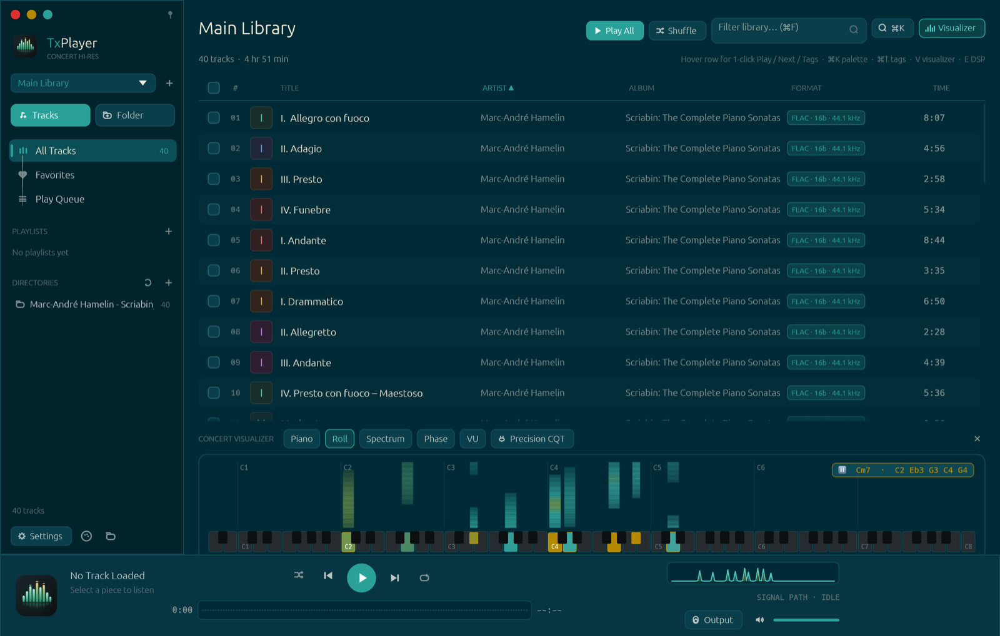

<div align="center">


# TxPlayer

**A calm, native Rust audiophile music player, real-time 88-key concert piano & acoustic visualizer, and offline master music library database.**

[](Cargo.toml)
[](https://tuxie.eu/txplayer)
[](Cargo.toml)
[](#multi-platform-build--packaging)
[](#features)
[](Cargo.toml)

**[Website & Live Docs (tuxie.eu/txplayer)](https://tuxie.eu/txplayer)** · **[5-Minute Quick Start](docs/QUICK_START.md)** · **[Complete User Guide](docs/USER_GUIDE.md)** · **[Roadmap](ROADMAP.md)**

</div>

---

## Screenshots (Solarized Dark)

<p align="center">
  
</p>

<details open>
<summary><b>More Views — 88-Key Concert Piano Roll, Pluggable Modules & 64-Bit Audio DSP</b></summary>

| 88-Key Concert Piano Roll | Pluggable Modules & Runtime Health |
| :---: | :---: |
|  |  |

| Real-Time 64-Bit Interactive EQ, Convolution IR & Mastering Console |
| :---: |
|  |

</details>

---

## Features (`v1.10.0`)

### Bit-Perfect Hi-Res Audio, Native DoP v1.1 & 64-Bit Studio DSP
- **Wide Audiophile & Archive Format Support:** Native pure-Rust SIMD decoding for `FLAC`, `ALAC`, `WAV`, `AIFF`, `CAF`, `MP3`, `AAC`, `M4A`, `OGG/Vorbis`, `MKV`, `WebM`, native 1-bit `DSF` / `DFF` (DSD64–DSD512), `.cue` sheets (UTF-8 / CP1250 / Windows-1252 / Shift-JIS), plus extended archive support for **WavPack (`.wv`)**, **Monkey's Audio (`.ape`)**, **Opus (`.opus`)**, and Scarlet Book **SACD `.iso`** Master TOC inspection.
- **Bit-Perfect, Exclusive DAC & Native DSD over PCM (DoP v1.1):** CoreAudio Hog Mode & hardware clock matching, Direct `0.0 dBFS` Volume Lock, Play-from-RAM pre-buffering, per-device saved audio profiles, synchronous `2×/4×/Max` Rubato Blackman-Harris oversampling, and live `I32` DoP v1.1 transport with automatic 64-bit LUT FIR PCM fallback.
- **Lock-Free 64-Bit Real-Time DSP Suite (`<10 ms` latency, zero audio-thread allocations):**
  - **Interactive Drag-to-Shape 10-Band EQ Canvas** (`31 Hz – 16 kHz`, drag nodes directly on the live `20 Hz – 20 kHz` curve, double-click to reset).
  - **16-Band Parametric EQ & AutoEQ / Oratory1990 `.txt` Importer**.
  - **Partitioned FFT Stereo Convolution Engine (`.wav` IR):** Built-in acoustic presets (`Analog Warmth`, `Intimate Chamber`, `Mastering Air`) + custom mono/stereo `.wav` IR loader (`16,384` taps, Wet/Dry Mix, IR Gain).
  - **Named Headphone Crossfeed Presets** (`Gentle`, `Chu Moy`, `Jan Meier`, `Bauer Studio`), **TPDF & 2nd-Order Noise-Shaped Dither**, **Mastering Console** (`L/R Balance`, `Mono`, `Ø Polarity`, `L ↔ R Swap`), and **Instant DSP A/B Toggle (`D`)**.
- **Interactive Signal Path Inspector:** Live 5-stage bit-path telemetry with top-level fidelity verdict banner (`BIT-PERFECT` / `NATIVE DSD OVER PCM` / `STUDIO DSP`).

### 6 Real-Time Concert Visualizers
- **88-Key Piano Spectrum (`Precision CQT`):** Multi-rate Butterworth-decimated Constant-Q analyzer with Railsback stretch tuning, 10-voice iterative harmonic cancellation, dynamics-aware coloring (`pp → ff`), live chord readout, and **Pause-Freeze study mode**.
- **88-Key Concert Piano Roll:** Scrolling real-time note waterfall rising off the keybed.
- **64-Band Spectrum RTA:** Logarithmic `27.5 Hz – 18 kHz` analyzer with peak-hold ticks.
- **Live Acoustic Spectrogram (Sonogram):** Scrolling 2D time-frequency thermal heatmap with log frequency ticks and live dominant `PEAK Hz` readout.
- **Stereo Scope & Vectorscope:** Zero-crossing stereo oscilloscope paired with an M/S phase goniometer.
- **Mastering VU & Phase:** Segmented L/R VU meters, live **EBU R128 Momentary/Short-Term LUFS**, **4× True Peak (`dBTP`)**, and phase correlation.

### Master Music Library Database & Collector Intelligence
- **Relational Library Database v2:** Persists full classical metadata (`Composer`, `Conductor`, `Orchestra`, `Work / Opus`, `Record Label`, `Catalog #`, `Comment`, `#custom-tags`), Collector Album Liner Notes, Play History (`2,000` plays), and permanent DR/LUFS/TruePeak/TrueHz audit scores with rolling `libraries.json.bak` protection.
- **9 Browse Facets & Classical Multi-Disc Album Hero:** Browse `Tracks | Albums | Artists | Composers | Works | Genres | Labels | Years | Folders`, inspect multi-disc headers, launch `.pdf` album booklets, browse High-Res cover/inlay scan galleries, and see inline color-coded **`DR`** pills right in the track table.
- **Curated Collections, Visual Smart Query Builder & Power-Search:** Drag-to-collection boxes, 16-field AND/OR dynamic Smart Views, and instant Power-Search tokens (`composer:beethoven dr>=12 rate>=96 codec:flac label:dg #reference`).
- **Batch Multi-Track Tag Transforms & Online Matcher:** MusicBrainz, iTunes (+ 600 px Cover Art), AcoustID, plus 1-click off-thread **Batch Transforms** (`Filename → Tags`, `Swap Artist ↔ Composer`, `Strip Track #`, `Smart Title Case`, `Auto-Number 1..N`, `Find & Replace All`, `+ #Tag All`).
- **Quality Auditing & Portable Catalog Export:** Parallel pure-Rust **TrueHz / DR Authenticity Auditor**, **EBU R128 ReplayGain Scanner**, **Duplicate Quality Audit** (fidelity-ranked `BEST` master badge), **100% Local Similar Radio**, **Interactive Insights Analytics**, and 1-click export to print-ready **HTML Dossier (`.html`)**, **Markdown Catalog (`.md`)**, **CSV (`.csv`)**, and **JSON Backup/Restore**.
- **Critical Listening & Polish:** A–B Section Looper (`[` / `]` / `\`) with clickable transport pill, Per-Track Bookmarks (`⌘B`), Sleep Timer with 5s fade-out, Synced Lyrics (`.lrc`), 1-Click Copy Audiophile Specs, 9 Studio Themes, Compact Mini-Player Mode, and `⌘K` / `Ctrl+K` Command Palette.

---

## Documentation
- **[5-Minute Quick Start & First Steps](docs/QUICK_START.md)** — Uncover TxPlayer's full audiophile and library potential in 5 steps.
- **[Complete User Guide & Reference](docs/USER_GUIDE.md)** — Deep documentation of every audio stage, DSP module, query token, shortcut, and collector workflow.
- **[Web Presentation & Online Docs](https://tuxie.eu/txplayer)** — Full showcase and searchable online manual.

---

## Multi-Platform Build & Packaging

### Prerequisites
- **Rust 1.95+** (`rustup update stable`)
- **Optional runtime tools** (checked in *Settings → Plugins*): `ffmpeg` (lossless tag writing & `.wv`/`.ape`/`.opus` playback), `fpcalc` (Chromaprint), `curl`
- **Linux system dev libraries (Debian/Ubuntu):**
  ```bash
  sudo apt-get install -y libasound2-dev libgtk-3-dev libxcb-render0-dev libxcb-shape0-dev libxcb-xfixes0-dev libxkbcommon-dev libssl-dev pkg-config
  ```

### Build, Test & Run
```bash
# Run all 50 unit tests & strict clippy lint
cargo test
cargo clippy --all-targets -- -D warnings

# Run optimized release build (~8.5 MB native binary)
cargo run --release
```

### macOS App Bundle
```bash
./scripts/package-macos.sh
```
Produces a signed `target/macos/TxPlayer.app` (with Retina `AppIcon.icns`) and `target/macos/TxPlayer.dmg`.
