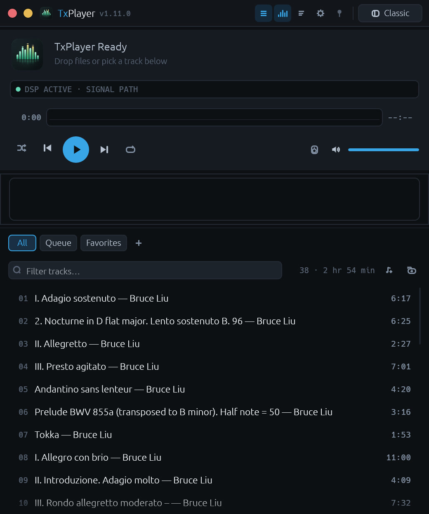
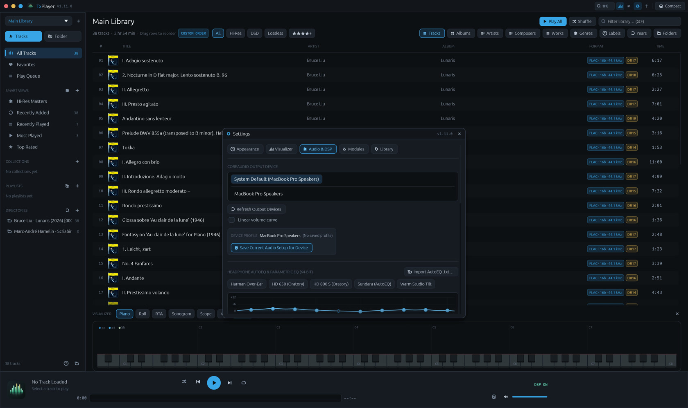

<div align="center">


# TxPlayer

**Fast, 100% free native Rust audiophile music player, 88-key piano &amp; spectrogram visualizer, and offline master music library.**

[](https://github.com/tuxie80/txplayer/releases/latest) [](LICENSE) [](#download) [](Cargo.toml) [](docs/USER_GUIDE.md) [](https://gemini.google.com/)

**[Website &amp; Tour (tuxie.eu/txplayer)](https://tuxie.eu/txplayer)** · **[Download Installers](https://github.com/tuxie80/txplayer/releases/latest)** · **[5-Min Quick Start](docs/QUICK_START.md)** · **[Full User Guide](docs/USER_GUIDE.md)**

</div>

---

<table>
  <tr>
    <th align="center" width="38%">Compact Mini-Player (<code>⌘⇧M</code>)</th>
    <th align="center" width="62%">Classic Studio &amp; 88-Key Piano Visualizer</th>
  </tr>
  <tr>
    <td align="center" valign="middle"></td>
    <td align="center" valign="middle"></td>
  </tr>
</table>

---

## Download

Grab ready-to-run native installers from **[GitHub Releases (`v1.12.3`)](https://github.com/tuxie80/txplayer/releases/latest)**:

| Platform | Installer | Portable |
| :--- | :--- | :--- |
| **macOS (Apple Silicon)** | [`TxPlayer-v1.12.3-macos-arm64.dmg`](https://github.com/tuxie80/txplayer/releases/download/v1.12.3/TxPlayer-v1.12.3-macos-arm64.dmg) | [`txplayer-v1.12.3-macos-arm64.tar.gz`](https://github.com/tuxie80/txplayer/releases/download/v1.12.3/txplayer-v1.12.3-macos-arm64.tar.gz) |
| **Windows (x64)** | [`TxPlayer-v1.12.3-windows-x86_64-setup.exe`](https://github.com/tuxie80/txplayer/releases/download/v1.12.3/TxPlayer-v1.12.3-windows-x86_64-setup.exe) | [`txplayer-v1.12.3-windows-x86_64.zip`](https://github.com/tuxie80/txplayer/releases/download/v1.12.3/txplayer-v1.12.3-windows-x86_64.zip) |
| **Linux (x86_64)** | [`txplayer_1.12.3_amd64.deb`](https://github.com/tuxie80/txplayer/releases/download/v1.12.3/txplayer_1.12.3_amd64.deb) | [`txplayer-v1.12.3-linux-x86_64.tar.gz`](https://github.com/tuxie80/txplayer/releases/download/v1.12.3/txplayer-v1.12.3-linux-x86_64.tar.gz) |

---

## Highlights

### Supported Formats
- **Lossless PCM:** `FLAC`, `ALAC` (`.m4a`, `.mp4`), `WAV` (`.wav`, `.wave`), `AIFF` (`.aif`, `.aiff`, `.aifc`), `CAF` (`.caf`), `WavPack` (`.wv`), `Monkey's Audio` (`.ape`) — up to 32-bit / 384 kHz+.
- **DSD &amp; SACD:** `DSF` (`.dsf`) and `DSDIFF` (`.dff`) (`DSD64`, `DSD128`, `DSD256`, `DSD512`) via **Native DoP v1.1** (`0x05/0xFA`) or 64-bit Blackman-Harris LUT FIR PCM decimation, plus multi-track **Scarlet Book SACD `.iso`** direct stereo DSD64 playback.
- **Lossy &amp; Containers:** `MP3`, `MP2`, `MP1`, `AAC`, `M4A`, `MP4`, `Ogg Vorbis` (`.ogg`, `.oga`), `Opus` (`.opus`), `WebM` (`.webm`), `Matroska` (`.mka`, `.mkv`).
- **Disc Images, Cue Sheets, Playlists &amp; Extras:** `CUE sheets` (`.cue`, UTF-8 / UTF-16 / CP1250 / Windows-1250 &amp; multi-FILE), raw Red-Book CD-DA `.bin`, `M3U` / `M3U8` / `PLS` playlists, synced `LRC` (`.lrc`) &amp; embedded lyrics, `.pdf` digital booklets, and high-res cover scans (`.jpg`, `.png`, `.webp`).

### Layouts, Themes &amp; Everyday Usability
- **Compact &amp; Classic Layouts:** Instant toggle (`⌘⇧M` / `Ctrl+Shift+M`) between the minimal **Compact Mini-Player** and the full **Classic Studio** workspace, remembering independent window sizes and positions.
- **9 Built-In Themes:** Obsidian Studio, Studio Reference, Tokyo Night, Tokyo Night Storm, Solarized Dark, Solarized Light, Nord, Catppuccin Mocha, and Gruvbox Dark.
- **Fast Navigation &amp; Built-In Help:** Drag &amp; drop folders or files, 3 acoustic waveform scrubber styles, `⌘K` Command Palette, built-in `F1` Quick Guide overlay, OS media keys / MPRIS / macOS Now Playing, and system tray controls.
- **100% Free, Native &amp; Local:** Pure Rust (~8.5 MB binary), zero Electron, zero accounts, zero cloud, zero telemetry, 61/61 unit tests passing.

### Bit-Perfect Audio Engine &amp; DAC Output
- **Exclusive DAC &amp; Clock Sync:** CoreAudio Hog Mode (macOS), WASAPI (Windows), and ALSA / PipeWire (Linux) exclusive access with automatic hardware sample-rate switching.
- **Audiophile Signal Path:** Direct Volume Lock (`0.0 dBFS` unity), Play-from-RAM pre-buffering, pure gapless album playback, optional smooth crossfade, optional Rubato Sinc `2× / 4× / Max` synchronous oversampling, clickable live Signal Path popover, and 1-click **Copy Audiophile Specs**.
- **Per-Device Audio Profiles:** Automatically recalls Bit-Perfect DAC settings for USB DACs and headphone EQ / crossfeed profiles when switching outputs.

### 64-Bit Studio DSP &amp; Musician Practice
- **Interactive 10-Band EQ &amp; AutoEQ:** Drag glowing frequency nodes directly on the `20 Hz–20 kHz` response curve, or import 16-band Oratory1990 / EqualizerAPO `.txt` parametric headphone profiles.
- **64-Bit FFT Stereo Convolution:** Lock-free overlap-add convolution engine (up to `16,384` taps) supporting custom `.wav` impulse responses and built-in acoustic room presets.
- **Pitch-Locked Practice &amp; Tuning:** Variable playback speed (`0.75×–1.5×`) with dual-tap Hann **Pitch-Lock**, live `±12 st` transposition, and `A=440 / 432 / 415 Hz` concert pitch tuning.
- **Mastering Console &amp; Dither:** Constant-power Balance, Mono sum, `Ø` Polarity invert, `L↔R` channel swap, Bauer / Meier / Chu Moy headphone crossfeed, ReplayGain (Track / Album / Auto + EBU R128 scanner), TPDF &amp; noise-shaped dither, soft peak limiter, and instant **`D`** zero-click DSP A/B toggle.

### 6 Real-Time Concert Visualizers (`V`, `1`–`6`)
- **88-Key Precision CQT Piano:** 3-stage Butterworth multi-rate CQT (`1× / ÷4 / ÷16`), Railsback stretch tuning, 10-voice harmonic overtone cancellation, dynamics-colored keybed (`pp → mf → ff`), live chord readout, and **Pause-Freeze** chord study.
- **88-Key Concert Piano Roll:** Scrolling real-time note waterfall aligned to the grand keybed.
- **Live Acoustic Spectrogram:** `96 × 64` scrolling 2D time-frequency sonogram (`27.5 Hz–18 kHz`) with live `PEAK Hz` indicator.
- **64-Band Spectrum RTA, Stereo Scope &amp; Mastering VU:** Logarithmic RTA with peak-hold, zero-crossing stereo oscilloscope + M/S vectorscope, segmented VU meters + live EBU R128 Momentary/Short-Term LUFS, 4× True Peak (`dBTP`), phase correlation, and live `ms/frame` compute telemetry.

### Master Library Database &amp; Collector Tools
- **Rich Classical &amp; Collector Schema:** Multiple libraries, 9 browse facets (`Tracks`, `Albums`, `Artists`, `Composers`, `Works`, `Genres`, `Labels`, `Years`, `Folders`), Composer / Conductor / Orchestra / Work / Label / Catalog # / `#tags` / Ratings / Liner Notes, and Album Hero view with multi-disc dividers, `.pdf` booklet launcher &amp; scans gallery.
- **Organization &amp; Power-Search:** Collections, custom Playlists (drag-reorder, duplicate, dedupe), 16-field Smart Views, and instant Power-Search tokens (`composer:beethoven dr>=12 rate>=96 codec:flac #reference`).
- **Tagging &amp; Portable Dossiers:** 7 Batch Multi-Track Tag Transforms (`Filename → Tags`, `Swap Artist↔Composer`, `Strip Track #`, `Smart Title Case`, `Auto-Number`, `Find/Replace`, `+ #Tag`), online MusicBrainz / iTunes / AcoustID lookup with lossless `ffmpeg -c copy` tag writing, clickable **Library Insights** analytics, and print-ready **HTML**, **Markdown**, **CSV**, and **JSON** catalog exports.

### Critical Listening, Audits &amp; LAN Remote
- **Loudness-Matched Blind ABX Lab:** Auto EBU R128 loudness matching (`0.1 dB` accuracy), seamless randomized `A / B / X` switching at identical timestamps, and exact binomial `p-value` statistics.
- **TrueHz, DR &amp; Duplicate Audits:** Ultrasonic Hi-Res authenticity &amp; Dynamic Range (`DR`) scanner with inline `DR` track pills, plus fidelity-ranked `BEST` master duplicate finder.
- **Study &amp; Remote Tools:** 100% offline **Similar Radio**, A–B Section Looper (`[` / `]` / `\`) with clickable transport badge, per-track Timestamp Bookmarks (`⌘B`), Sleep Timer with smooth fade-out, and opt-in 100% local **LAN Mobile Remote** web controller over Wi-Fi.

---

## Build from Source

```bash
# Test, lint & run release build (Rust 1.95+)
cargo test && cargo run --release

# macOS signed .app bundle & .dmg
./scripts/package-macos.sh

# Linux .deb & portable .tar.gz
./scripts/package-linux.sh
```

> **Linux dev deps (Debian/Ubuntu):** `libasound2-dev libgtk-3-dev libxcb-render0-dev libxcb-shape0-dev libxcb-xfixes0-dev libxkbcommon-dev libssl-dev pkg-config`  
> **Optional helpers:** `ffmpeg` (lossless tag writing &amp; `.wv`/`.ape`/`.opus`), `fpcalc` (AcoustID), `curl`

---

## More Screenshots

| Live Acoustic Spectrogram &amp; Inline `DR` | Interactive Drag-to-Shape EQ &amp; 64-Bit DSP |
| :---: | :---: |
|  |  |

<p align="center">
  <strong>Loudness-Matched Blind ABX Comparison Lab</strong><br /><br />
  
</p>
