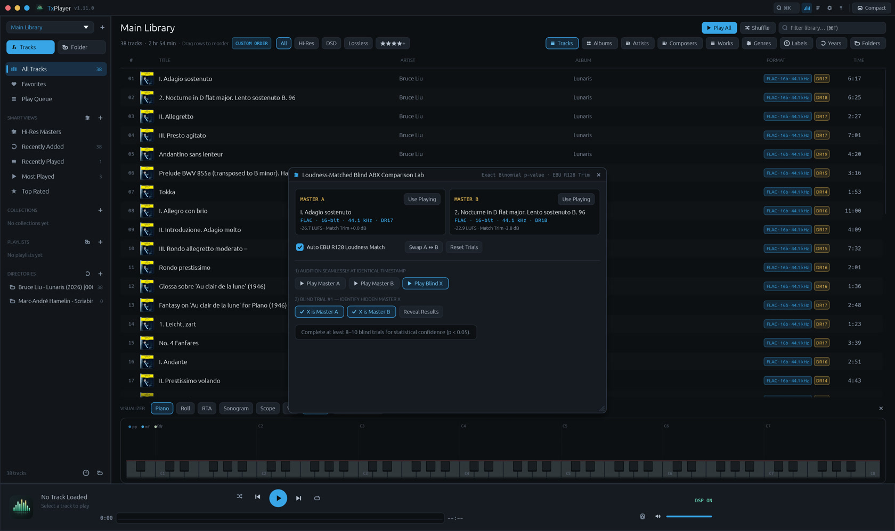

<div align="center">


# TxPlayer

**Fast, 100% free native Rust music player, 88-key piano &amp; spectrogram visualizer, and offline master music library.**

[](https://github.com/tuxie80/txplayer/releases/latest) [](LICENSE) [](#download) [](Cargo.toml) [](docs/USER_GUIDE.md) [](https://gemini.google.com/)

**[Website &amp; Tour (tuxie.eu/txplayer)](https://tuxie.eu/txplayer)** · **[Download Installers](https://github.com/tuxie80/txplayer/releases/latest)** · **[5-Min Quick Start](docs/QUICK_START.md)** · **[Full User Guide](docs/USER_GUIDE.md)**

</div>

---

<p align="center">
  
</p>

| Compact Mini-Player (`⌘⇧M`) | Live Acoustic Spectrogram &amp; Inline `DR` |
| :---: | :---: |
|  |  |

| Interactive Drag-to-Shape EQ &amp; 64-Bit DSP | Loudness-Matched Blind ABX Lab |
| :---: | :---: |
|  |  |

---

## Download

Grab ready-to-run native installers from **[GitHub Releases (`v1.12.1`)](https://github.com/tuxie80/txplayer/releases/latest)**:

| Platform | Installer | Portable |
| :--- | :--- | :--- |
| **macOS (Apple Silicon)** | [`TxPlayer-v1.12.1-macos-arm64.dmg`](https://github.com/tuxie80/txplayer/releases/download/v1.12.1/TxPlayer-v1.12.1-macos-arm64.dmg) | [`txplayer-v1.12.1-macos-arm64.tar.gz`](https://github.com/tuxie80/txplayer/releases/download/v1.12.1/txplayer-v1.12.1-macos-arm64.tar.gz) |
| **Windows (x64)** | [`TxPlayer-v1.12.1-windows-x86_64-setup.exe`](https://github.com/tuxie80/txplayer/releases/download/v1.12.1/TxPlayer-v1.12.1-windows-x86_64-setup.exe) | [`txplayer-v1.12.1-windows-x86_64.zip`](https://github.com/tuxie80/txplayer/releases/download/v1.12.1/txplayer-v1.12.1-windows-x86_64.zip) |
| **Linux (x86_64)** | [`txplayer_1.12.1_amd64.deb`](https://github.com/tuxie80/txplayer/releases/download/v1.12.1/txplayer_1.12.1_amd64.deb) | [`txplayer-v1.12.1-linux-x86_64.tar.gz`](https://github.com/tuxie80/txplayer/releases/download/v1.12.1/txplayer-v1.12.1-linux-x86_64.tar.gz) |

---

## Highlights

- **Simple to start:** Drag &amp; drop any folder, switch between **Compact Mini-Player** and **Classic Studio** (`⌘⇧M`), pick from **9 themes**, press **`F1`** anytime for built-in help.
- **Bit-Perfect &amp; Native DSD:** CoreAudio / WASAPI / ALSA Exclusive DAC access, Play-from-RAM, **DoP v1.1** (`DSD64`–`DSD512`), multi-track **SACD `.iso`**, plus `FLAC`, `ALAC`, `WAV`, `AIFF`, `WavPack`, `Monkey's Audio`, `Opus`, and `.cue`.
- **64-Bit Studio DSP &amp; Practice:** Draggable 10-band EQ canvas, AutoEQ PEQ import, partitioned FFT Convolution (`.wav` IR), **Pitch-Locked slowdown** (`0.75×–1.5×`), `±12 st` transpose, `A=440/432/415 Hz` tuning, and instant `D` DSP A/B bypass.
- **6 Real-Time Visualizers (`1`–`6`):** 88-Key Precision CQT Piano (with Pause-Freeze chords), Piano Roll, 64-Band RTA, Live Acoustic Spectrogram, Stereo Scope, and Mastering VU + live EBU R128 LUFS.
- **Master Library Database &amp; Collector Tools:** 9 browse facets, Collections, 16-field Smart Views, Power-Search (`composer:beethoven dr>=12 rate>=96 #reference`), 7 Batch Tag Transforms, TrueHz/DR &amp; ReplayGain audits, **Blind ABX Lab**, 100% local Similar Radio, HTML/Markdown/CSV dossiers, and opt-in **LAN Mobile Remote**.
- **100% Free &amp; Local:** Native Rust (~8.5 MB binary), zero Electron, zero cloud, zero telemetry, 55/55 unit tests passing.

---

## Build from Source

```bash
# Test, lint & run release build (Rust 1.95+)
cargo test && cargo run --release

# macOS signed .app bundle & .dmg
./scripts/package-macos.sh

# Linux .deb & portable .tar.gz
./scripts/package-linux.sh
```

> **Linux dev deps (Debian/Ubuntu):** `libasound2-dev libgtk-3-dev libxcb-render0-dev libxcb-shape0-dev libxcb-xfixes0-dev libxkbcommon-dev libssl-dev pkg-config`  
> **Optional helpers:** `ffmpeg` (lossless tag writing &amp; `.wv`/`.ape`/`.opus`), `fpcalc` (AcoustID), `curl`
