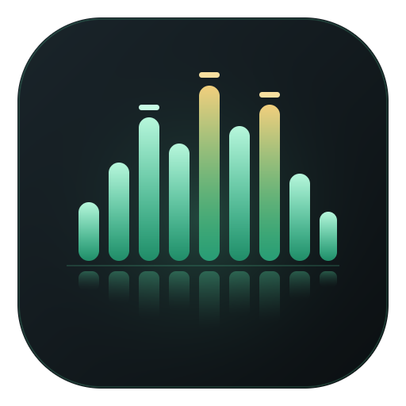
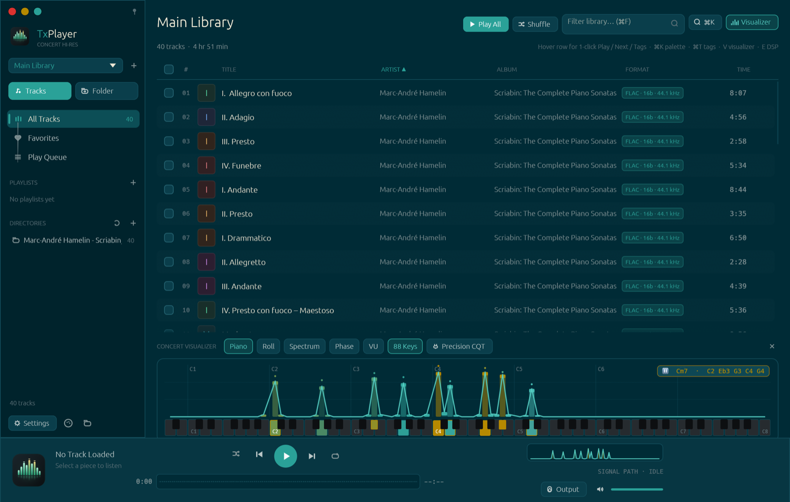
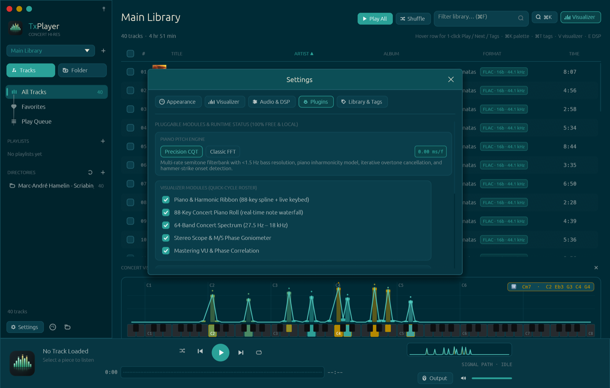
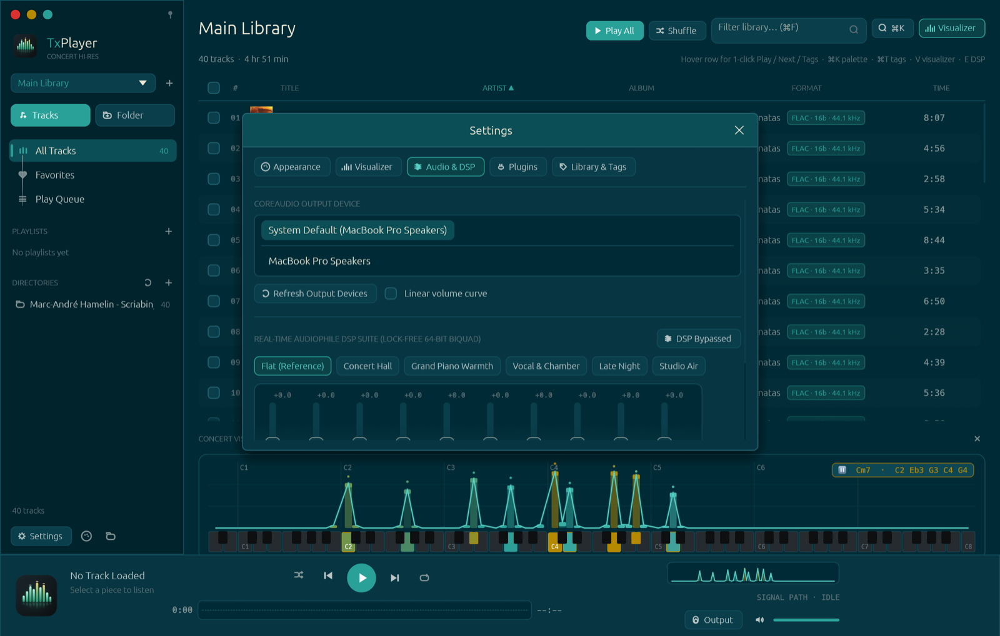

<div align="center">



# TxPlayer

**A calm, fast, high-resolution native music player & real-time 88-key concert piano visualizer.**

[](Cargo.toml)
[](Cargo.toml)
[](#multi-platform-build--packaging)
[](Cargo.toml)
[](Cargo.toml)
[](Cargo.toml)
[](https://deepmind.google)

</div>

---

## Screenshots (Solarized Dark)

<p align="center">
  
</p>

<details open>
<summary><b>More Views — 88-Key Concert Piano Roll, Pluggable Modules & 10-Band DSP</b></summary>

| 88-Key Concert Piano Roll | Pluggable Modules & Runtime Health |
| :---: | :---: |
|  |  |

| Real-Time 64-Bit Parametric EQ & Crossfeed DSP |
| :---: |
|  |

</details>

---

## Features

### Hi-Res Audio & Audiophile DSP
- **Wide Format Support:** Native pure-Rust SIMD decoding for `FLAC`, `ALAC`, `WAV`, `AIFF`, `CAF`, `MP3`, `AAC`, `M4A`, `OGG/Vorbis`, `MKV`, and `WebM`.
- **Native Sample-Rate Matching:** Automatically matches hardware DAC sample rates (`44.1 / 48 / 88.2 / 96 / 192 kHz`) and falls back transparently to a Blackman-Harris `SincFixedIn` resampler (`rubato`) for fixed-rate devices like Bluetooth A2DP speakers.
- **Hot-Switch Output Routing:** Seamless output switching across CoreAudio (macOS), WASAPI (Windows), and ALSA/PipeWire (Linux) without interrupting playback.
- **Lock-Free 64-Bit Real-Time DSP Suite:** Runs directly in the audio callback (`<10 ms` latency) with zero locks and zero heap allocations:
  - **10-Band Parametric EQ** (`31 Hz – 16 kHz`, `Q = 1.414`, 64-bit Direct Form II Transposed biquads, 6 curated studio presets + custom per-band sliders).
  - **Headphone Crossfeed:** Bauer-inspired `700 Hz` head-shadow acoustic bleed for natural speaker-like stereo imaging on headphones.
  - **Transparent Soft-Knee Limiter:** `-0.7 dBFS` clip guard with adjustable preamp gain and 1-click bit-direct bypass.
- **Interactive Signal Path Inspector:** Click the transport telemetry readout to inspect every live audio stage (`Decoder → Sample-Rate Stage → Real-Time DSP → Hardware Output → Piano Tap`) and toggle DSP presets inline.

### Real-Time 88-Key Piano Visualizer
- **Multi-Rate Constant-Q Semitone Analyzer (`Precision CQT`):** Analyzes a 16,384-sample lock-free tap across 3 Butterworth anti-aliased decimation stages (`1×`, `÷4`, `÷16`, auto-scaled for `88.2 / 96 / 192 kHz` Hi-Res streams) with Railsback piano stretch tuning.
- **10-Voice Iterative Harmonic Cancellation:** Scores each key using fundamental + partials (`2f..6f`) and iteratively subtracts modeled overtones from the residual spectrum to suppress false octave and fifth ghost keys.
- **Hammer-Strike Onset Detection & Keybed Animation:** Positive spectral-flux detection drives bright hammer-strike flashes and physical key depression on all 88 keys (`A0–C8`), with `C1–C8` octave boundary alignment and key labels.
- **Live Chord & Note Readout + Pause-Freeze:** Displays sounding notes and inferred chords (e.g. `Cm7 · C2 Eb3 G3 C4 G4`), and **freezes pressed keys, piano roll, and chord readout on Pause** for musical study.
- **5 Pluggable Visualizer Modes:**
  - `Piano & Harmonic Ribbon` (88-key spline + live keybed)
  - `88-Key Concert Piano Roll` (scrolling real-time note waterfall)
  - `64-Band Concert Spectrum` (`27.5 Hz – 18 kHz` with mirror reflection)
  - `Stereo Scope & M/S Phase Goniometer`
  - `Mastering VU & Phase Correlation`

### Low-Click, Theme-Aligned Interface
- **Full-Bleed Custom Window Chrome:** Removes the native OS title bar and replaces it with 100% theme-aligned window controls (`Close`, `Minimize`, `Zoom / Fullscreen`, `Always on Top`), top-edge window dragging, and borderless edge resizing on Windows/Linux.
- **8 Curated Studio Themes:** `Solarized Dark`, `Solarized Light`, `Obsidian Studio`, `Tokyo Night`, `Tokyo Night Storm`, `Nord`, `Catppuccin Mocha`, and `Gruvbox Dark`.
- **1-Click Row Workflow:** Hover any row for instant 1-click **Play/Pause**, **Play Next**, **Add to Queue**, **Edit Tags**, or **Favorite**, plus `Shift` / `Cmd` (`Ctrl`) multi-select with a floating batch dock.
- **Command Palette (`Cmd+K` / `Ctrl+K`):** Instant fuzzy jump to any track, playlist, library, theme, visualizer mode, EQ preset, or action.
- **Pluggable Modules Hub (`Settings → Plugins`):** Toggle visualizer modes, switch piano detection engines (`Precision CQT` vs `Classic 4096-pt FFT`) with live `ms/frame` telemetry, toggle DSP stages, and inspect tag providers + tool health (`ffmpeg`, `fpcalc`, `curl`).

### Libraries, Playlists & Online Tag Editor
- **Multiple Isolated Libraries:** Organize separate collections with watched directories, drag-and-drop import, Favorites, reorderable Playlists, and Play Queue management.
- **Fast Single & Batch Tag Editor:** Instant open via fast 256 KB audio-body hash (full SHA-256 + Chromaprint computed lazily), MusicBrainz (rate-limit safe), iTunes Search + **600 px Cover Art fetcher**, AcoustID, local hash cache, 1-click **Apply & Save** (`Cmd+Enter` / `Ctrl+Enter`), and lossless `ffmpeg -c copy` writes with proper cleared-field removal.

---

## Technical Architecture

### Core Stack
- **Language & Toolchain:** Rust Edition 2024 (`rustc 1.95+`), release profile with `opt-level = 3`, `lto = "thin"`, `codegen-units = 1`, `strip = true` (~8.5 MB native binary).
- **UI & Rendering:** `eframe` / `egui` `0.37` (`glow` GPU renderer), zero Electron/WebView overhead.
- **Audio Pipeline:** `symphonia 0.5` (`all`, `opt-simd`) → `rubato 0.16` (`SincFixedIn`) → lock-free `ringbuf 0.4` (3-second ring) → `cpal 0.18` real-time callback (`CoreAudio` / `WASAPI` / `ALSA`).

### Threading & Performance Model
1. **UI Thread (`eframe`):** Cached `visible_tracks` & sidebar stats invalidated only by state revisions (zero 60 Hz full-library cloning or re-sorting), precomputed FFT twiddle tables & CQT semitone kernels, and mode-gated visualizer DSP.
2. **Audio Decode Thread (`txplayer-audio`):** Packet decoding with reused `SampleBuffer`, Sinc resampling, live VBR/CBR bitrate telemetry, and automatic output-device hot-switch detection.
3. **Real-Time Audio Callback:** Lock-free atomic `SharedDspParams` sync → 64-bit `RealtimeDsp` → smoothed gain → lock-free `VisualTap` (`16,384` stereo frames).
4. **Artwork Worker (`txplayer-art`):** Background disk read and `160×160` thumbnail downscale keyed by `cover_path` (shared across all tracks on an album).
5. **On-Demand Workers:** Recursive directory scanning (`walkdir`), 160-bin acoustic waveform extraction, online metadata/cover lookup, and lossless tag writing.

### Project Layout
- `src/main.rs` — Cross-platform viewport bootstrap & unified `AppIcon` loading
- `src/platform.rs` — OS abstraction (`CoreAudio`/`WASAPI`/`ALSA`, `Finder`/`Explorer`/`xdg-open`, modifier labels)
- `src/audio.rs` — Symphonia decoder, `SincFixedIn` resampler, CPAL stream manager, lock-free `VisualTap`
- `src/dsp.rs` — Lock-free `SharedDspParams` & 64-bit real-time `RealtimeDsp` (10-band EQ, crossfeed, soft limiter)
- `src/visualizer.rs` — Multi-rate Butterworth-decimated CQT piano engine, harmonic cancellation, chord detector, 5 visualizer renderers
- `src/plugins.rs` — Pluggable module registry, presets, and `preferences.json` schema
- `src/app.rs` — Main application state, cached table/sidebar, custom themed window chrome, shortcuts, async artwork
- `src/modals.rs` — Settings hub, anchored popovers (Audio Output & Signal Path), `Cmd+K` Command Palette, Tag Editor & Track Inspector
- `src/tagger.rs` — MusicBrainz / iTunes / AcoustID / local hash lookup, pure-Rust SHA-256, cover download, lossless `ffmpeg` writer
- `src/theme.rs` & `src/icons.rs` — 8 studio palettes and pure-vector UI icon renderer

---

## Keyboard Shortcuts

| Action | macOS | Windows / Linux |
| :--- | :---: | :---: |
| Quick Command Palette | `⌘K` | `Ctrl+K` |
| Focus Search Filter | `⌘F` | `Ctrl+F` |
| Edit Tags / Track Inspector | `⌘T` / `⌘I` | `Ctrl+T` / `Ctrl+I` |
| Open Settings | `⌘,` | `Ctrl+,` |
| Play / Pause | `Space` | `Space` |
| Mute / Unmute | `M` | `M` |
| Toggle Concert Visualizer | `V` | `V` |
| Toggle Audio DSP (Bit-Direct Bypass) | `E` | `E` |
| Switch Visualizer Mode | `1`–`5` | `1`–`5` |
| Seek ±10 s / Prev & Next Track | `←` `→` / `⌘←` `⌘→` | `←` `→` / `Ctrl+←` `Ctrl+→` |
| Volume ±5% | `⌘↑` `⌘↓` | `Ctrl+↑` `Ctrl+↓` |
| Dismiss Popover / Modal | `Esc` | `Esc` |

---

## Multi-Platform Build & Packaging

### Prerequisites
- **Rust 1.95+** (`rustup update stable`)
- **Optional runtime tools** (for lossless file tag writing & acoustic fingerprinting): `ffmpeg`, `fpcalc` (Chromaprint), `curl`
- **Linux system dev libraries (Debian/Ubuntu):**
  ```bash
  sudo apt-get install -y libasound2-dev libgtk-3-dev libxcb-render0-dev libxcb-shape0-dev libxcb-xfixes0-dev libxkbcommon-dev libssl-dev pkg-config
  ```

### Build & Run (macOS, Windows, Linux)
```bash
# Run unit tests & lint
cargo test
cargo clippy --all-targets -- -D warnings

# Run optimized release build
cargo run --release
```

### macOS App Bundle
```bash
./scripts/package-macos.sh
```
Produces a signed `target/macos/TxPlayer.app` (with full multi-resolution Retina `AppIcon.icns`) and `target/macos/TxPlayer.dmg`.
